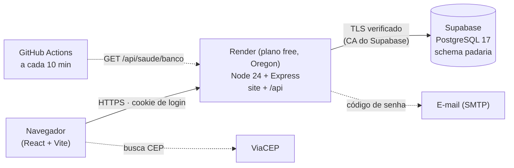
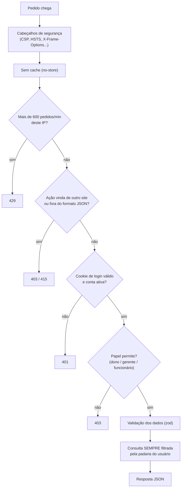
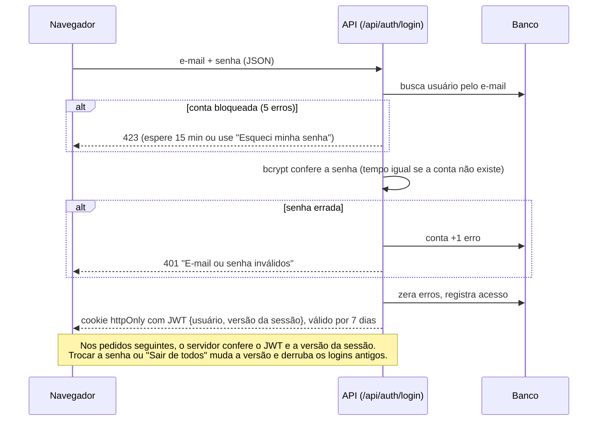
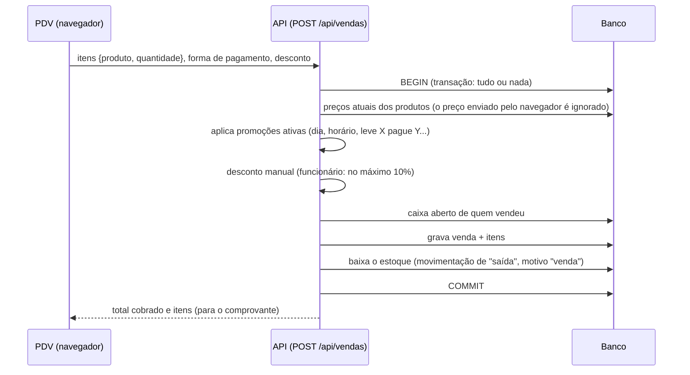

# Arquitetura do Padaria Info

Como o sistema funciona de ponta a ponta. Para os detalhes, veja [API.md](API.md) (todas as rotas) e [BANCO.md](BANCO.md) (todas as tabelas). Esses dois arquivos são gerados por `npm run docs`.

## Visão geral

| Peça | O que faz | Onde está |
|---|---|---|
| Site (front-end) | Telas: PDV, estoque, caixa, equipe etc. React, gerado em `dist/` | [src/](../src/) |
| Servidor (API) | Regras de negócio, login e acesso ao banco. Também entrega o site. | [server/](../server/) |
| Banco | Todos os dados. Estrutura em `server/schema.sql`, aplicada ao iniciar. | Supabase |
| Hospedagem | Faz o deploy sozinho a cada push na `main` ([render.yaml](../render.yaml)) | Render |
| Cutucada | Impede o Render de dormir e o Supabase de pausar | [.github/workflows/manter-acordado.yml](../.github/workflows/manter-acordado.yml) |

## Caminho de um pedido na API

Todo pedido para `/api` passa pelas mesmas camadas, nesta ordem ([server/index.ts](../server/index.ts)):

## Login

## Uma venda no PDV

Na devolução (`POST /api/vendas/:id/devolver`, só dono ou gerente), a venda vira "devolvida", sai de todos os totais e o estoque volta.

## Papéis

| Papel | Pode |
|---|---|
| **dono** | Tudo, incluindo Equipe, convites, dados da padaria e metas |
| **admin** (gerente) | Toda a operação: produtos, preços, promoções, contas, análise, margens, devoluções |
| **funcionario** | PDV, caixa próprio, estoque, produção, encomendas, perdas, histórico de vendas (para a 2ª via) |

A lista completa, rota por rota, está em [API.md](API.md).

## Segurança e verificação

- `npm run teste:seguranca` faz 45 ataques reais num servidor isolado: login, isolamento entre padarias, papéis, SQL injection, CSRF, vazamentos e força bruta.
- Senhas guardadas só com bcrypt. O código de recuperação é guardado só como hash, vale 15 minutos e aceita 5 tentativas.
- Banco: RLS ligado em todas as tabelas (a API pública do Supabase não lê nada), conexão TLS verificada e chaves estrangeiras garantindo os vínculos.
- LGPD: o registro de acessos é apagado depois de 1 ano. CPF repetido não revela o titular, e os logs não guardam dados pessoais.

## Decisões em aberto (para o dono decidir)

- **Faturamento visível ao funcionário:** o histórico de vendas é aberto a todos, porque o balcão precisa achar a venda para a 2ª via, e ele mostra o total do período. Se o faturamento deve ser só da gerência, dá para esconder os totais para o papel `funcionario`.
- **Usuário do banco:** o servidor conecta como `postgres`, que pode tudo. Um usuário só com as permissões necessárias limitaria o estrago se a senha vazasse.

## Comandos úteis

| Comando | Para quê |
|---|---|
| `npm run dev` + `npm run dev:server` | Rodar no computador (site + API) |
| `npm run banco:local` | Banco PostgreSQL local para testes (sem Supabase) |
| `npm run teste:seguranca` | Teste de segurança automático |
| `npm run docs` | Regenerar `docs/API.md` e `docs/BANCO.md` |
| `npm run build` | Gerar o site de produção (o Render faz isso sozinho) |
