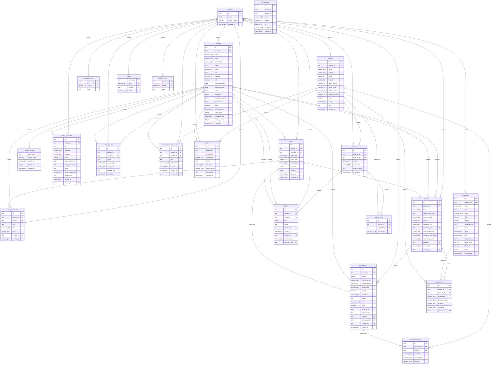

<!-- Arquivo gerado por `npm run docs` (scripts/gerar-docs.mjs). Não edite à mão. -->

# Banco de dados

PostgreSQL (Supabase), schema `padaria`. **22 tabelas**, **44 chaves estrangeiras**, **58 índices**. Fonte da verdade: [server/schema.sql](../server/schema.sql), aplicado sozinho quando o servidor inicia.

> Multi-padaria: toda tabela de negócio tem `padaria_id`, e toda consulta do servidor filtra por ele. Todas as tabelas têm RLS ligado e sem políticas: só o servidor lê. A API pública do Supabase não enxerga nada.

## Diagrama ER

## Tabelas

### caixa_movimentos

| Coluna | Tipo | Obrigatória | Padrão | Chave |
|---|---|---|---|---|
| `id` | text | sim |  | PK |
| `padaria_id` | text | sim |  | → padarias |
| `caixa_id` | text | sim |  | → caixas (on delete cascade) |
| `tipo` | text | sim |  |  |
| `valor` | numeric(10,2) | sim |  |  |
| `motivo` | varchar(255) |  |  |  |
| `created_by` | text |  |  | → usuarios |
| `created_at` | timestamptz | sim | `now()` |  |

Regras: `CHECK ((tipo = ANY (ARRAY['sangria'::text, 'suprimento'::text])))` · `CHECK ((valor > (0)::numeric))`

Índices: `(caixa_id)`

### caixas

Caixa (gaveta) de cada operador: abertura com fundo de troco, sangrias/suprimentos e fechamento.

| Coluna | Tipo | Obrigatória | Padrão | Chave |
|---|---|---|---|---|
| `id` | text | sim |  | PK |
| `padaria_id` | text | sim |  | → padarias |
| `operador_id` | text | sim |  | → usuarios |
| `aberto_em` | timestamptz | sim | `now()` |  |
| `fundo_troco` | numeric(10,2) | sim | `0` |  |
| `fechado_em` | timestamptz |  |  |  |
| `esperado` | jsonb |  |  |  |
| `contado` | jsonb |  |  |  |
| `diferenca` | numeric(10,2) |  |  |  |
| `observacoes` | varchar(500) |  |  |  |

Índices: `(operador_id, fechado_em)` · `(padaria_id, aberto_em)`

### categorias_fotos

Foto de uma categoria de produto, por padaria.

| Coluna | Tipo | Obrigatória | Padrão | Chave |
|---|---|---|---|---|
| `padaria_id` | text | sim |  | PK |
| `nome` | varchar(255) | sim |  | PK |
| `foto` | text | sim |  |  |

### codigos_senha

Esqueci minha senha: código de 6 dígitos (só o hash), 15 minutos, poucas tentativas.

| Coluna | Tipo | Obrigatória | Padrão | Chave |
|---|---|---|---|---|
| `usuario_id` | text | sim |  | PK |
| `codigo_hash` | char(64) | sim |  |  |
| `expira_em` | timestamptz | sim |  |  |
| `tentativas` | integer | sim | `0` |  |
| `created_at` | timestamptz | sim | `now()` |  |

### contas_financeiras

| Coluna | Tipo | Obrigatória | Padrão | Chave |
|---|---|---|---|---|
| `id` | text | sim |  | PK |
| `padaria_id` | text | sim |  | → padarias |
| `tipo` | text | sim |  |  |
| `descricao` | varchar(255) | sim |  |  |
| `categoria` | varchar(255) |  |  |  |
| `valor` | numeric(10,2) | sim |  |  |
| `data_vencimento` | date | sim |  |  |
| `data_pagamento` | date |  |  |  |
| `status` | text | sim | `'pendente'::text` |  |
| `forma_pagamento` | varchar(50) |  |  |  |
| `observacoes` | text |  |  |  |
| `created_at` | timestamptz | sim | `now()` |  |
| `created_by` | text |  |  | → usuarios |

Regras: `CHECK ((status = ANY (ARRAY['pendente'::text, 'pago'::text, 'cancelado'::text])))` · `CHECK ((tipo = ANY (ARRAY['pagar'::text, 'receber'::text])))` · `CHECK ((valor >= (0)::numeric))`

Índices: `(padaria_id, data_vencimento)`

### encomendas

Encomendas: número sequencial por padaria, sinal e status. Ao entregar vira venda (venda_id).

| Coluna | Tipo | Obrigatória | Padrão | Chave |
|---|---|---|---|---|
| `id` | text | sim |  | PK |
| `padaria_id` | text | sim |  | → padarias |
| `numero` | integer | sim |  |  |
| `cliente_nome` | varchar(120) | sim |  |  |
| `cliente_telefone` | varchar(11) |  |  |  |
| `retirada_em` | timestamptz | sim |  |  |
| `entrega` | boolean | sim | `false` |  |
| `endereco` | varchar(255) |  |  |  |
| `status` | text | sim | `'reservada'::text` |  |
| `total` | numeric(10,2) | sim | `0` |  |
| `sinal` | numeric(10,2) | sim | `0` |  |
| `forma_sinal` | text |  |  |  |
| `observacoes` | text |  |  |  |
| `venda_id` | text |  |  | → vendas |
| `caixa_sinal_id` | text |  |  | → caixas |
| `created_by` | text |  |  | → usuarios |
| `created_at` | timestamptz | sim | `now()` |  |

Regras: `CHECK ((forma_sinal = ANY (ARRAY['dinheiro'::text, 'cartao_credito'::text, 'cartao_debito'::text, 'pix'::text])))` · `UNIQUE (padaria_id, numero)` · `CHECK ((status = ANY (ARRAY['reservada'::text, 'confirmada'::text, 'em_producao'::text, 'pronta'::text, 'entregue'::text, 'cancelada'::text])))`

Índices: `(caixa_sinal_id) WHERE (caixa_sinal_id IS NOT NULL)` · `UNIQUE (padaria_id, numero)` · `(padaria_id, retirada_em)` · `(venda_id)`

### encomendas_itens

| Coluna | Tipo | Obrigatória | Padrão | Chave |
|---|---|---|---|---|
| `id` | text | sim |  | PK |
| `encomenda_id` | text | sim |  | → encomendas (on delete cascade) |
| `produto_id` | text | sim |  | → produtos |
| `quantidade` | numeric(10,3) | sim |  |  |
| `preco_unitario` | numeric(10,2) | sim |  |  |
| `subtotal` | numeric(10,2) | sim |  |  |

Regras: `CHECK ((preco_unitario >= (0)::numeric))` · `CHECK ((quantidade > (0)::numeric))`

Índices: `(encomenda_id)` · `(produto_id)`

### historico_perfil

Histórico de mudanças de perfil (nome, cargo, papel, foto).

| Coluna | Tipo | Obrigatória | Padrão | Chave |
|---|---|---|---|---|
| `id` | text | sim |  | PK |
| `padaria_id` | text |  |  | → padarias |
| `usuario_id` | text | sim |  | → usuarios |
| `campo` | text | sim |  |  |
| `valor_antigo` | varchar(255) |  |  |  |
| `valor_novo` | varchar(255) |  |  |  |
| `alterado_por` | text |  |  | → usuarios |
| `created_at` | timestamptz | sim | `now()` |  |

Regras: `CHECK ((campo = ANY (ARRAY['nome'::text, 'cargo'::text, 'papel'::text, 'foto'::text])))`

Índices: `(padaria_id, created_at)` · `(usuario_id)`

### log_acessos

Registro de acessos (logins, falhas, bloqueios, recuperação e troca de senha).

| Coluna | Tipo | Obrigatória | Padrão | Chave |
|---|---|---|---|---|
| `id` | text | sim |  | PK |
| `padaria_id` | text |  |  |  |
| `usuario_id` | text |  |  |  |
| `email` | varchar(255) |  |  |  |
| `evento` | varchar(30) | sim |  |  |
| `ip` | varchar(64) |  |  |  |
| `navegador` | varchar(255) |  |  |  |
| `created_at` | timestamptz | sim | `now()` |  |

Índices: `(padaria_id, created_at)`

### metas

Metas de vendas. alvo: 'geral' (padaria toda), 'pessoa' (padrão da equipe) ou id de usuário.

| Coluna | Tipo | Obrigatória | Padrão | Chave |
|---|---|---|---|---|
| `padaria_id` | text | sim |  | PK |
| `alvo` | varchar(36) | sim |  | PK |
| `periodo` | text | sim |  | PK |
| `valor` | numeric(12,2) | sim |  |  |

Regras: `CHECK ((periodo = ANY (ARRAY['dia'::text, 'semana'::text, 'mes'::text])))` · `CHECK ((valor > (0)::numeric))`

### movimentacoes_estoque

| Coluna | Tipo | Obrigatória | Padrão | Chave |
|---|---|---|---|---|
| `id` | text | sim |  | PK |
| `padaria_id` | text | sim |  | → padarias |
| `produto_id` | text | sim |  | → produtos |
| `tipo` | text | sim |  |  |
| `quantidade` | numeric(10,3) | sim |  |  |
| `motivo` | varchar(255) |  |  |  |
| `created_at` | timestamptz | sim | `now()` |  |
| `created_by` | text |  |  | → usuarios |

Regras: `CHECK ((tipo = ANY (ARRAY['entrada'::text, 'saida'::text, 'ajuste'::text])))`

Índices: `(created_by, created_at)` · `(padaria_id, created_at)` · `(produto_id)`

### padaria_config

Configurações por padaria (ex.: meta de CMV).

| Coluna | Tipo | Obrigatória | Padrão | Chave |
|---|---|---|---|---|
| `padaria_id` | text | sim |  | PK |
| `chave` | varchar(60) | sim |  | PK |
| `valor` | text | sim |  |  |

### padarias

Padarias (SaaS). dados = cadastro (nome, CNPJ, endereço...) em JSON. codigo_convite: o funcionário informa em "Criar conta" para pedir acesso à equipe.

| Coluna | Tipo | Obrigatória | Padrão | Chave |
|---|---|---|---|---|
| `id` | text | sim |  | PK |
| `dados` | jsonb | sim |  |  |
| `codigo_convite` | char(8) | sim |  |  |
| `created_at` | timestamptz | sim | `now()` |  |

Regras: `UNIQUE (codigo_convite)`

Índices: `UNIQUE (codigo_convite)`

### perdas

Perdas (sobra, vencido, queimado...). custo_unitario = preço de custo no momento.

| Coluna | Tipo | Obrigatória | Padrão | Chave |
|---|---|---|---|---|
| `id` | text | sim |  | PK |
| `padaria_id` | text | sim |  | → padarias |
| `produto_id` | text | sim |  | → produtos |
| `quantidade` | numeric(10,3) | sim |  |  |
| `motivo` | text | sim |  |  |
| `observacao` | varchar(255) |  |  |  |
| `custo_unitario` | numeric(10,2) | sim | `0` |  |
| `created_by` | text |  |  | → usuarios |
| `created_at` | timestamptz | sim | `now()` |  |

Regras: `CHECK ((motivo = ANY (ARRAY['sobra'::text, 'vencido'::text, 'queimado'::text, 'quebra'::text, 'outro'::text])))` · `CHECK ((quantidade > (0)::numeric))`

Índices: `(padaria_id, created_at)` · `(produto_id)`

### producoes

| Coluna | Tipo | Obrigatória | Padrão | Chave |
|---|---|---|---|---|
| `id` | text | sim |  | PK |
| `padaria_id` | text | sim |  | → padarias |
| `receita_id` | text | sim |  | → receitas |
| `data` | date | sim |  |  |
| `status` | text | sim | `'planejado'::text` |  |
| `observacoes` | text |  |  |  |
| `created_at` | timestamptz | sim | `now()` |  |
| `created_by` | text |  |  | → usuarios |
| `concluida_em` | timestamptz |  |  |  |
| `concluida_por` | text |  |  | → usuarios |

Regras: `CHECK ((status = ANY (ARRAY['planejado'::text, 'concluido'::text, 'cancelado'::text])))`

Índices: `(concluida_por, concluida_em)` · `(padaria_id, data)` · `(receita_id)`

### produtos

| Coluna | Tipo | Obrigatória | Padrão | Chave |
|---|---|---|---|---|
| `id` | text | sim |  | PK |
| `padaria_id` | text | sim |  | → padarias |
| `nome` | varchar(255) | sim |  |  |
| `categoria` | varchar(255) |  |  |  |
| `grupo` | varchar(80) |  |  |  |
| `unidade` | varchar(20) | sim | `'un'::character varying` |  |
| `preco_venda` | numeric(10,2) | sim |  |  |
| `preco_custo` | numeric(10,2) |  |  |  |
| `estoque_atual` | numeric(10,3) | sim | `0` |  |
| `estoque_minimo` | numeric(10,3) | sim | `0` |  |
| `ativo` | boolean | sim | `true` |  |
| `emoji` | varchar(16) |  |  |  |
| `foto` | text |  |  |  |
| `created_at` | timestamptz | sim | `now()` |  |

Regras: `CHECK ((preco_custo >= (0)::numeric))` · `CHECK ((preco_venda >= (0)::numeric))`

Índices: `(padaria_id)`

### promocoes

Promoções automáticas: %, R$ por unidade, preço fixo ou leve X pague Y; com período, dias da semana (0 = domingo) e horário.

| Coluna | Tipo | Obrigatória | Padrão | Chave |
|---|---|---|---|---|
| `id` | text | sim |  | PK |
| `padaria_id` | text | sim |  | → padarias |
| `nome` | varchar(80) | sim |  |  |
| `tipo` | text | sim |  |  |
| `valor` | numeric(10,2) | sim | `0` |  |
| `leve` | integer |  |  |  |
| `pague` | integer |  |  |  |
| `abrangencia` | text | sim |  |  |
| `alvos` | jsonb |  |  |  |
| `inicio` | timestamptz |  |  |  |
| `fim` | timestamptz |  |  |  |
| `dias_semana` | jsonb |  |  |  |
| `hora_inicio` | char(5) |  |  |  |
| `hora_fim` | char(5) |  |  |  |
| `ativa` | boolean | sim | `true` |  |
| `created_at` | timestamptz | sim | `now()` |  |

Regras: `CHECK ((abrangencia = ANY (ARRAY['produtos'::text, 'categorias'::text, 'tudo'::text])))` · `CHECK ((tipo = ANY (ARRAY['percentual'::text, 'valor'::text, 'preco_fixo'::text, 'leve_pague'::text])))`

Índices: `(padaria_id)`

### receita_itens

| Coluna | Tipo | Obrigatória | Padrão | Chave |
|---|---|---|---|---|
| `id` | text | sim |  | PK |
| `receita_id` | text | sim |  | → receitas (on delete cascade) |
| `ingrediente_id` | text | sim |  | → produtos |
| `quantidade` | numeric(10,3) | sim |  |  |

Regras: `CHECK ((quantidade > (0)::numeric))`

Índices: `(ingrediente_id)` · `(receita_id)`

### receitas

| Coluna | Tipo | Obrigatória | Padrão | Chave |
|---|---|---|---|---|
| `id` | text | sim |  | PK |
| `padaria_id` | text | sim |  | → padarias |
| `produto_id` | text | sim |  | → produtos |
| `nome` | varchar(255) | sim |  |  |
| `rendimento` | numeric(10,3) | sim |  |  |
| `modo_preparo` | text |  |  |  |
| `created_at` | timestamptz | sim | `now()` |  |

Regras: `CHECK ((rendimento > (0)::numeric))`

Índices: `(padaria_id)` · `(produto_id)`

### usuarios

papel: dono (tudo + Equipe), admin (gerente: toda a operação), funcionario (PDV, estoque, produção).

| Coluna | Tipo | Obrigatória | Padrão | Chave |
|---|---|---|---|---|
| `id` | text | sim |  | PK |
| `padaria_id` | text |  |  | → padarias |
| `nome` | varchar(255) | sim | `''::character varying` |  |
| `email` | varchar(255) | sim |  |  |
| `senha_hash` | varchar(255) | sim |  |  |
| `papel` | text | sim | `'funcionario'::text` |  |
| `cargo` | varchar(60) | sim | `''::character varying` |  |
| `foto` | text |  |  |  |
| `telefone` | varchar(11) |  |  |  |
| `cpf` | char(11) |  |  |  |
| `data_nascimento` | date |  |  |  |
| `data_admissao` | date |  |  |  |
| `turno` | text |  |  |  |
| `endereco` | jsonb |  |  |  |
| `contato_emergencia` | jsonb |  |  |  |
| `observacoes` | text |  |  |  |
| `ativo` | boolean | sim | `true` |  |
| `ultimo_acesso` | timestamptz |  |  |  |
| `falhas_login` | integer | sim | `0` |  |
| `bloqueado_ate` | timestamptz |  |  |  |
| `sessao_versao` | integer | sim | `0` |  |
| `created_at` | timestamptz | sim | `now()` |  |

Regras: `UNIQUE (email)` · `CHECK ((papel = ANY (ARRAY['dono'::text, 'admin'::text, 'funcionario'::text])))` · `CHECK ((turno = ANY (ARRAY['manha'::text, 'tarde'::text, 'noite'::text, 'madrugada'::text, 'integral'::text])))`

Índices: `(cpf) WHERE (cpf IS NOT NULL)` · `UNIQUE (email)` · `(padaria_id)`

### vendas

status: concluida | devolvida (devolvida não entra em nenhum total; o estoque já voltou).

| Coluna | Tipo | Obrigatória | Padrão | Chave |
|---|---|---|---|---|
| `id` | text | sim |  | PK |
| `padaria_id` | text | sim |  | → padarias |
| `total` | numeric(10,2) | sim |  |  |
| `forma_pagamento` | text | sim |  |  |
| `valor_recebido` | numeric(10,2) |  |  |  |
| `status` | varchar(20) | sim | `'concluida'::character varying` |  |
| `devolvida_em` | timestamptz |  |  |  |
| `devolvida_por` | text |  |  | → usuarios |
| `motivo_devolucao` | varchar(255) |  |  |  |
| `desconto_promocoes` | numeric(10,2) | sim | `0` |  |
| `desconto_manual` | numeric(10,2) | sim | `0` |  |
| `caixa_id` | text |  |  | → caixas |
| `created_at` | timestamptz | sim | `now()` |  |
| `created_by` | text |  |  | → usuarios |

Regras: `CHECK ((forma_pagamento = ANY (ARRAY['dinheiro'::text, 'cartao_credito'::text, 'cartao_debito'::text, 'pix'::text])))` · `CHECK ((total >= (0)::numeric))`

Índices: `(caixa_id)` · `(created_by, created_at)` · `(padaria_id, created_at)`

### vendas_itens

| Coluna | Tipo | Obrigatória | Padrão | Chave |
|---|---|---|---|---|
| `id` | text | sim |  | PK |
| `venda_id` | text | sim |  | → vendas (on delete cascade) |
| `produto_id` | text | sim |  | → produtos |
| `quantidade` | numeric(10,3) | sim |  |  |
| `preco_unitario` | numeric(10,2) | sim |  |  |
| `subtotal` | numeric(10,2) | sim |  |  |
| `desconto` | numeric(10,2) | sim | `0` |  |
| `promocao_id` | text |  |  | → promocoes (on delete set null) |

Regras: `CHECK ((preco_unitario >= (0)::numeric))` · `CHECK ((quantidade > (0)::numeric))` · `CHECK ((subtotal >= (0)::numeric))`

Índices: `(produto_id)` · `(venda_id)`
